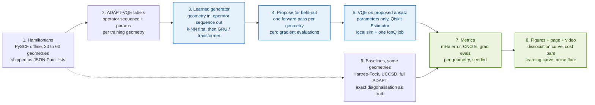

# GenQAI miniature hackathon plan

As of Oct 10, 2026 · Udaya Vijay Anand

Live, editable version of this plan: https://claude.ai/code/artifact/e4732e12-eb44-462a-b4e5-f05c875fb81a

## What we are building

A miniature of Quantinuum, NVIDIA and Pfizer's ADAPT-GQE: a learned model that proposes a molecule's ground-state circuit in one shot, replacing the expensive operator search in ADAPT-VQE, demonstrated end to end in Qiskit on IonQ's simulator.

The claim in one paragraph: for a small molecule across a sweep of geometries, a model trained on ADAPT-VQE outputs predicts an ansatz that reaches chemical accuracy (error below 1.6 mHa against exact diagonalisation) on held-out geometries, using zero operator-gradient evaluations where ADAPT-VQE needs hundreds, and with circuits no deeper than ADAPT's. Hartree-Fock, the production classical method, misses chemical accuracy by tens of mHa on the same stretched geometries. Every number is measured, seeded and reproducible on a free simulator.

Theme: Quantum Impact (pharmaceutical R&D is an "other industry"). Judged by IonQ engineers on novelty, technical execution, impact, documentation. Hackathon rules: Qiskit, runs on Qollab's free simulators including IonQ's, MIT licence, project page, 2 to 3 minute video, built inside the window with any starter code disclosed.

## Background: what we are miniaturising

VQE finds a molecule's ground-state energy by preparing a parameterised circuit (the ansatz), measuring the Hamiltonian's expectation, and letting a classical optimiser tune the parameters. The hard part is choosing the ansatz. UCCSD is the textbook choice but is deep and fixed. ADAPT-VQE (Grimsley et al. 2019) grows the ansatz greedily: at every step it computes the energy gradient for every operator in a pool, appends the one with the largest gradient, re-optimises all parameters, and repeats until gradients fall below a threshold. It yields compact, accurate circuits at the price of pool-size gradient evaluations per step and a full re-optimisation per step.

GenQAI (ADAPT-GQE) replaces that loop with a learned proposal. Quantinuum, NVIDIA and Pfizer ran GPU-accelerated ADAPT-VQE (CUDA-Q) on thousands of imipramine conformers at 12, 14 and 16 active-space qubits, fine-tuned Nemotron and Gemma 3 transformers on the resulting circuits, applied GRPO against energy, and had the model emit a full circuit in a single forward pass. They report circuit generation 3 to 4 orders of magnitude faster than ADAPT-VQE, accuracy matching or exceeding the training data, and execution on Helios-1 (98 qubits). Circuit depths and numeric energy errors are not in the public write-up ([Quantum Computing Report](https://quantumcomputingreport.com/quantinuum-nvidia-and-pfizer-validate-generative-quantum-ai-genqai-framework-for-pharmaceutical-rd/), [arXiv 2607.22468](https://arxiv.org/pdf/2607.22468)).

Our substitutions, same claim shape:

| Their setup | Our miniature |
| --- | --- |
| Imipramine conformers from MD | LiH or H4 at 30 to 60 bond lengths |
| 12 to 16 active-space qubits | 4 to 8 qubits (frozen core, minimal basis) |
| Nemotron / Gemma 3 + GRPO | Nearest-neighbour baseline, then a small GRU or 2-layer transformer |
| CUDA-Q GPU data generation | Statevector simulation on a laptop |
| Helios-1 execution | One IonQ simulator job (ideal + forte-1 noise model) |
| Not reported: depth, energy error | Reported: CNOT count, mHa error, gradient evaluations saved |

## The scientific question and the honest claim

The question: can a model trained on ADAPT-VQE circuits for some geometries of a molecule propose circuits for unseen geometries that reach chemical accuracy without running the operator search? If yes, how much search is saved and does circuit depth suffer?

What we can defend with numbers:

1. Quantum-native accuracy win. On stretched bonds (LiH beyond 2.5 Å, H4 beyond 1.5 Å) Hartree-Fock is wrong by 20 to 100 mHa; a VQE with the right ansatz matches exact diagonalisation to under 1.6 mHa. This is the one place at 4 to 8 qubits where "quantum beats the classical production method" is a true sentence, because the classical baseline is a real method people use, not a toy.
2. Search amortisation. ADAPT-VQE costs (pool size) × (steps) gradient evaluations plus a re-optimisation per step. The learned proposal costs one forward pass and one final optimisation. We report the ratio per geometry.
3. Depth parity. The predicted ansatz has CNOT count within a stated margin of ADAPT's and far below UCCSD's.
4. Generalisation. Accuracy holds on held-out geometries, with a learning curve: how many training geometries are needed before held-out error drops below 1.6 mHa.

What we do not claim:

- That the ML model is quantum. It is a classical model trained on quantum-simulation data, exactly as in the original.
- That anything is faster in wall-clock terms this weekend. The simulator is a classical computer; exact diagonalisation at 8 qubits is instant. The cost model is gradient evaluations and circuit executions, which is what matters at 50+ qubits where exact methods die.
- That hardware would reproduce the energies. We show the forte-1 noise-model curve so the gap is visible.

The README sentence: "We reproduce the ADAPT-GQE idea at hackathon scale: a learned ansatz generator that removes the operator search from ADAPT-VQE on LiH, reaching chemical accuracy on held-out geometries with N× fewer gradient evaluations and comparable depth, measured against Hartree-Fock, UCCSD, ADAPT-VQE and exact diagonalisation."

## System design

Blue: the quantum path that replaces ADAPT's search. Green: outputs. Dashed: the same Hamiltonians feed the baselines.

Stages 1, 2 and 6 are classical preprocessing and baselines, run once and cached. Stages 3 to 5 are the contribution: the generator proposes, VQE only tunes parameters. Everything in stages 5 to 8 runs on Qollab's free local simulator; one circuit also goes to the IonQ simulator.

Stage-by-stage detail:

1. Hamiltonians. For each bond length, PySCF computes one- and two-electron integrals in STO-3G, Qiskit Nature maps them (Jordan-Wigner or parity, two-qubit reduction) to a qubit Hamiltonian. Save each as a JSON list of (Pauli string, coefficient) plus the Hartree-Fock bitstring and the exact ground-state energy from NumPy diagonalisation. This is the only step that needs PySCF; shipping JSON means the Qollab runtime never has to install it.
2. ADAPT-VQE labels. Our own ~150-line implementation over a qubit-excitation pool: at each step compute the commutator gradient for every pool operator on the current state, pick the largest, append, re-optimise with COBYLA or L-BFGS-B, stop at gradient norm below 1e-3 or chemical accuracy. Record the operator index sequence, final parameters, energy, gradient-evaluation count and CNOT count per geometry.
3. Learned generator. Input: geometry features (bond length, and for H4 the two spacings). Output: operator index sequence. Baseline A is k-nearest-neighbour over bond length (copy the nearest training geometry's sequence). Baseline B is a 2-layer GRU or tiny transformer decoding the sequence token by token, trained with cross-entropy on the ADAPT sequences, plus warm-started parameters from the nearest neighbour.
4. Propose. For every held-out geometry, one forward pass gives the sequence. No gradients over the pool, no stepwise re-optimisation.
5. VQE on the proposed ansatz. Build the circuit from the sequence, optimise only its parameters from the warm start with Qiskit's StatevectorEstimator. Count circuit executions and optimiser iterations.
6. Baselines on the same Hamiltonians: Hartree-Fock energy (free), UCCSD VQE (Qiskit Nature ansatz, same optimiser), full ADAPT-VQE run fresh on the held-out geometry (the thing we are replacing), exact diagonalisation (truth).
7. Metrics per geometry and per method, written to a CSV with seeds.
8. Figures, the project page, the video.

## Molecules, qubit budgets and the operator pool

LiH is the primary molecule: it has real correlation on stretching, a one-dimensional geometry (bond length), and a tiny qubit count after freezing the core. H4 is the stretch target because its two independent spacings make the generalisation claim stronger. H2 is the smoke test only.

| Molecule | Basis, reduction | Qubits | Geometry sweep | Pool size (qubit excitations) | Why |
| --- | --- | --- | --- | --- | --- |
| H2 | STO-3G, parity + 2-qubit reduction | 2 | 0.5 to 2.5 Å, 20 points | ~3 | Pipeline smoke test, should run in minutes |
| LiH | STO-3G, frozen 1s core, parity reduction | 4 to 6 | 1.0 to 3.5 Å, 40 to 60 points | 20 to 60 | Primary: strong HF failure past 2.5 Å, ADAPT needs 5 to 12 operators |
| H4 chain | STO-3G, Jordan-Wigner | 8 | two spacings, 1.0 to 2.0 Å grid, 36 to 64 points | ~80 | Stretch: 2-D geometry input, real strong correlation |
| BeH2 | STO-3G, frozen core | 6 to 8 | symmetric stretch | ~100 | Only if H4 lands early |

Operator pool: the qubit-excitation pool (Yordanov et al. 2021), singles and doubles as Pauli-exponential gates, because it is small, hardware-efficient and has a closed-form gradient. Each operator becomes a short fixed gate block, so an operator index sequence fully determines the circuit and the CNOT count. Sequence lengths of 5 to 15 tokens over a vocabulary of 20 to 100 operators is a toy sequence-modelling problem, which is the point.

Train/test split: hold out every fourth geometry, plus the two most stretched ones, so the model is tested on interpolation and on mild extrapolation. Report both separately.

## Baselines and metrics

Every method runs on the same Hamiltonians, the same optimiser (COBYLA, then L-BFGS-B polish) with the same iteration cap, and the same seeds. Judges will look for an untuned baseline; UCCSD and ADAPT get the same optimiser budget as our method.

| Method | Role | Cost we count | Expected accuracy on stretched LiH |
| --- | --- | --- | --- |
| Hartree-Fock | Classical production baseline | zero | Wrong by 20 to 100 mHa |
| Exact diagonalisation | Ground truth | zero (8 qubits is instant) | Exact by definition |
| UCCSD VQE | Fixed quantum ansatz | circuit executions, CNOTs | Chemical accuracy, deep circuit |
| ADAPT-VQE, fresh | The method we replace | pool gradients × steps + re-optimisations | Chemical accuracy, compact circuit |
| k-NN proposal + VQE | Our baseline A | one final optimisation | Chemical accuracy on interpolation, likely fails on extrapolation |
| Learned generator + VQE | Our method B | one forward pass + one final optimisation | Chemical accuracy on both splits (the claim) |

Metrics, all per geometry, averaged over 5 seeds with standard error:

- Energy error against exact, in mHa. Chemical accuracy line at 1.6 mHa.
- Fraction of held-out geometries under 1.6 mHa (interpolation and extrapolation reported separately).
- Gradient evaluations: pool size × ADAPT steps for ADAPT, zero for ours. The headline ratio.
- Circuit executions through the final optimisation (Estimator calls), so the "one optimisation instead of twelve" saving is also counted.
- CNOT count after transpiling to IonQ's native gate set, ours vs ADAPT vs UCCSD.
- Ansatz-sequence agreement with ADAPT's own choice on held-out geometries (token-level accuracy), as a diagnostic, not a headline.
- Learning curve: held-out error as a function of number of training geometries (5, 10, 20, 40).
- Noise: energy error of the proposed circuit on IonQ's forte-1 noise model for one geometry, shown next to the ideal result.

The pass bar for the project: on LiH, the learned generator reaches chemical accuracy on at least 90% of interpolation geometries and on the two extrapolation geometries, with zero pool gradient evaluations and CNOT count within 20% of ADAPT's. If extrapolation fails, that is reported as a finding, not hidden.

## The evidence figures

Four figures carry the project page. Each is generated by one script from the metrics CSV, so a judge can rerun it.

1. Dissociation curve. Energy vs bond length for LiH: exact (line), Hartree-Fock (visibly diverging past 2.5 Å), UCCSD, ADAPT, and our proposal on held-out points (markers). Below it, a residual panel in mHa with the 1.6 mHa band. This is the figure that shows the quantum-native win and that our proposal sits inside the band.
2. Cost bars. Per held-out geometry: gradient evaluations and circuit executions for ADAPT vs ours, log scale. The orders-of-magnitude gap is the GenQAI claim at our scale.
3. Depth comparison. CNOT count after IonQ-native transpilation: UCCSD vs ADAPT vs ours, per geometry. Shows we did not buy speed with depth.
4. Learning curve. Held-out mHa error vs number of training geometries, k-NN and learned generator as two series, interpolation and extrapolation as separate panels. Shows how much ADAPT data the model needs, which is the question a pharma team would ask.

One supporting figure: ideal vs forte-1 noise-model energy for a single proposed circuit, with the exact value marked. It will miss chemical accuracy; that is the honest hardware caveat and it takes one sentence.

Figure hygiene: fixed seeds in the file names, error bars from 5 seeds, axes labelled with units, the chemical-accuracy line on every energy plot, colour consistent across figures (one colour per method).

## Stack, dependencies and platform constraints

Two environments: a local build environment with the chemistry stack, and the Qollab runtime that must run the submitted project with no chemistry dependencies at all. Everything that needs PySCF happens locally and is committed as data.

| Layer | Local (data generation) | Qollab runtime (what judges run) |
| --- | --- | --- |
| Qiskit | qiskit 2.5.x, pinned below 3.0 | same |
| Chemistry | pyscf, qiskit-nature 0.7.x for mapping | none; Hamiltonians read from JSON |
| Simulation | StatevectorEstimator, qiskit-aer if present | StatevectorEstimator (Qollab local sim), qiskit-ionq for the one IonQ job |
| Optimiser | scipy COBYLA / L-BFGS-B | same |
| ML | numpy k-NN; PyTorch for the GRU | numpy k-NN always; PyTorch only if the runtime has it, else load saved predictions |
| Plots | matplotlib | matplotlib |

Known facts about the platform from the rules and FAQ, and what we do about each:

- Projects must be Qiskit and run on Qollab's free simulators. Judges press Run on a local simulator; the IonQ job neither adds nor subtracts points. So the notebook must complete end to end on the local simulator from the cached JSON in a few minutes, with the IonQ cell optional.
- Exactly one IonQ job per run. We submit one proposed-ansatz circuit at its optimised parameters, as a multi-circuit job if we also want the noise-model variant. IonQ ideal simulator: 29 qubits, returns probabilities; forte-1 noise model available and seedable.
- Preinstalled packages inside Qollab are unverified. Mitigation: the notebook's first cell checks imports and falls back; qiskit-nature is only imported locally; a vendored 150-line ADAPT-VQE and a vendored UCCSD builder mean nothing depends on qiskit-nature at run time.
- Qiskit 2.x deprecations: avoid BlueprintCircuit-based library classes slated for removal in 3.0; build the ansatz from PauliEvolutionGate or explicit gate blocks.
- Build window Oct 9 19:00 to Oct 11 19:00 ET; MIT licence; project page and public 2 to 3 minute video are hard requirements; starter code disclosed on the page. ADAPT-VQE and the qubit-excitation pool are prior published algorithms and are cited; all code is written in the window.

Repository layout:

- `data/hamiltonians/{molecule}/{geometry}.json`, `data/adapt_labels/{molecule}.csv`, `data/metrics.csv`
- `src/hamiltonians.py` (local only), `src/pool.py`, `src/adapt.py`, `src/generator.py`, `src/vqe.py`, `src/baselines.py`, `src/metrics.py`, `src/plots.py`
- `notebooks/00_smoke_h2.ipynb`, `01_generate_labels.ipynb`, `02_train_generator.ipynb`, `03_evaluate.ipynb`, `04_ionq_job.ipynb`
- `README.md`, `LICENSE` (MIT), `figures/`

## Work breakdown

```mermaid
gantt
    title Four phases, each gated by a figure that must exist
    dateFormat X
    axisFormat %s

    section Chemistry + ADAPT
    H2 JSON                          :a1, 0, 12
    LiH sweep + ADAPT labels         :crit, a2, 12, 42

    section Baselines + VQE
    UCCSD + optimiser harness        :b1, 12, 42
    Fresh ADAPT, metrics CSV         :b2, 42, 72

    section Generator
    k-NN proposal, schema            :c1, 12, 42
    GRU + learning curve             :crit, c2, 42, 72

    section Platform + IonQ
    Qollab run                       :d1, 0, 12
    IonQ job, noise curve            :d2, 72, 100

    section Page + video
    README + figure scripts          :e1, 42, 72
    Video, submit                    :crit, e2, 72, 100

    section Gates
    H2 end-to-end on Qollab          :milestone, g1, 12, 0
    Fig 1 with ADAPT markers         :milestone, g2, 42, 0
    Figs 2 to 4 from metrics CSV     :milestone, g3, 72, 0
```

Critical-path items are marked. Diamonds are gates: nothing in the next phase starts until that artefact exists. The axis is relative effort, not clock time.

Phases are ordered by dependency, not by clock: the plan holds whether the team has one evening or three days. Lanes map to owners; with two people, one takes Chemistry + Generator and the other Baselines + Platform, and both do Page + video.

Phase 1, smoke (gate: H2 runs end to end on Qollab). Hamiltonian JSON for H2, a 2-qubit ansatz, VQE to exact, the notebook uploaded and run on Qollab's local simulator. This proves the runtime, the import fallbacks and the JSON format before anything expensive is built.

Phase 2, labels and baselines (gate: Figure 1 with ADAPT markers). LiH sweep of 40 to 60 geometries with exact and Hartree-Fock energies; the vendored ADAPT-VQE producing operator sequences, parameters, gradient counts and CNOT counts per geometry; UCCSD on the same geometries; the shared optimiser harness with seeds. In parallel the generator lane defines the sequence schema and the k-NN proposal.

Phase 3, generator and evaluation (gate: Figures 2 to 4 from the metrics CSV). Train the GRU, evaluate k-NN and GRU on held-out geometries, run fresh ADAPT on held-out geometries as the comparison, fill metrics.csv, produce the learning curve. If the GRU does not beat k-NN, the README says so and k-NN is the method.

Phase 4, ship. One IonQ job (ideal and forte-1), the noise figure, final README, the 2 to 3 minute video (problem, pipeline diagram, Figure 1, Figure 2, honesty slide), submission on Qollab with licence and disclosure.

- [ ] Phase 1 gate: H2 notebook runs on Qollab
- [ ] Phase 2 gate: Figure 1 exists with ADAPT markers inside the 1.6 mHa band
- [ ] Phase 3 gate: metrics.csv complete, Figures 2 to 4 generated by script
- [ ] Phase 4: IonQ job done, video public, project page published under MIT

## Risks and fallbacks

| Risk | How we would notice | Fallback |
| --- | --- | --- |
| Qollab runtime lacks PySCF or qiskit-nature | Phase 1 import cell fails | Already designed around: all chemistry is cached JSON, ADAPT and UCCSD are vendored |
| Qollab runtime lacks PyTorch | Phase 1 import cell fails | k-NN is the method; GRU predictions are saved to CSV and loaded, with the training notebook kept for transparency |
| ADAPT-VQE converges slowly or picks long sequences on stretched LiH | Phase 2: more than 15 operators or gradient stalls | Loosen stop threshold to 1e-2 on the gradient norm, cap at 12 operators, report that we compare at equal depth |
| GRU does not beat k-NN | Phase 3 learning curve flat | Report honestly; k-NN becomes the headline, GRU a negative result. Novelty survives because the measurement is the contribution |
| Extrapolation geometries fail chemical accuracy | Phase 3 metrics | Report interpolation and extrapolation separately; failure on extrapolation is a known limit of the original too |
| Optimiser gets stuck in a local minimum on UCCSD or ADAPT | Energy error well above exact with zero gradient | Warm start from Hartree-Fock parameters (zeros), 3 random restarts, best-of reported for every method equally |
| IonQ job fails or queues | Phase 4 | Not scored; the local run is what judges execute. Keep the cell optional and state so |
| Noise-model result looks bad | Phase 4 | Expected. One sentence in the README; it is the honesty slide in the video |
| Novelty scored low because the idea is Quantinuum's | Judging | The page leads with what the original does not publish: depth, mHa error, gradient counts, learning curve, a working open implementation |
| Scope creep to H4 or BeH2 | Phase 2 running long | LiH is the deliverable; H4 only after Figures 1 to 4 exist for LiH |

## Deliverables checklist

- [ ] Qollab project, MIT licence, runs end to end on the free local simulator from cached JSON in under 10 minutes
- [ ] `data/`: Hamiltonian JSON for every geometry, ADAPT label CSV, metrics CSV with seeds
- [ ] `src/`: vendored ADAPT-VQE, qubit-excitation pool, UCCSD builder, generator (k-NN and GRU), VQE harness, metrics, plots
- [ ] `notebooks/03_evaluate.ipynb` reproduces Figures 1 to 4 from the CSV with one Run
- [ ] `notebooks/04_ionq_job.ipynb`: one IonQ simulator job (ideal + forte-1), optional, clearly marked
- [ ] `figures/`: fig1_dissociation.png, fig2_cost.png, fig3_depth.png, fig4_learning_curve.png, fig5_noise.png
- [ ] Project page: what it does, how to run, the five figures, disclosure of prior algorithms used, hardware caveat
- [ ] Video, 2 to 3 minutes, public link, no sign-in
- [ ] Attribution line and starter-code disclosure as the rules require

Project page structure, in this order:

1. One-sentence claim with the headline number (gradient evaluations saved, fraction at chemical accuracy).
2. Why it matters: Hartree-Fock fails on stretched bonds; ADAPT fixes it but the search is the cost; GenQAI amortises the search; we show it works at hackathon scale and publish the numbers the original did not.
3. Pipeline diagram.
4. Figures 1 to 4, each with a two-sentence reading.
5. What we do not claim (the three bullets from the honest-claim section) and the noise figure.
6. How to run: three commands.
7. Prior work and disclosure: ADAPT-VQE (Grimsley 2019), qubit-excitation pool (Yordanov 2021), ADAPT-GQE (Quantinuum/NVIDIA/Pfizer 2026), all code written in the window.

Video script, 150 seconds: 20 s problem (HF fails, show the curve diverging), 30 s what ADAPT does and what it costs, 30 s our generator and the pipeline diagram, 40 s Figures 1 and 2 with the numbers read aloud, 20 s honesty slide (classical model, simulator, noise floor), 10 s how to run it.

## Stretch goals

Only after Figures 1 to 4 exist for LiH, in this order:

1. H4 chain with two geometric inputs, to show the generator handles a 2-D geometry space. Doubles the qubit count to 8 and makes the generalisation claim much stronger.
2. GRPO-lite: after supervised training, fine-tune the generator with a reward of minus the VQE energy on a few sampled sequences per geometry. This is the step the original used to beat its own training data; even a small improvement over the supervised model is a direct reproduction of their headline.
3. Cross-molecule transfer: train on LiH, test on BeH2 with a shared pool vocabulary. Likely fails; a clean negative result is still worth a paragraph.
4. Pool-pruning diagnostic: which operators the generator never emits, and whether dropping them from ADAPT's pool speeds ADAPT itself up. A small classical finding with a direct cost story.
5. Depth-aware decoding: penalise CNOT count at inference so the generator trades a little energy for a shallower circuit, and plot the frontier.

## Sources

- [Quantinuum, NVIDIA and Pfizer validate GenQAI framework (Quantum Computing Report)](https://quantumcomputingreport.com/quantinuum-nvidia-and-pfizer-validate-generative-quantum-ai-genqai-framework-for-pharmaceutical-rd/)
- [Learning to Prepare Molecular Ground States with Transformer Models (arXiv 2607.22468)](https://arxiv.org/pdf/2607.22468)
- [Grimsley et al., An adaptive variational algorithm for exact molecular simulations, Nat. Commun. 2019](https://www.nature.com/articles/s41467-019-10988-2)
- [Yordanov et al., Qubit-excitation-based adaptive variational quantum eigensolver, Commun. Phys. 2021](https://www.nature.com/articles/s42005-021-00730-0)
- Qollab hackathon rules and FAQ (qollab.xyz), as read on Oct 9, 2026
